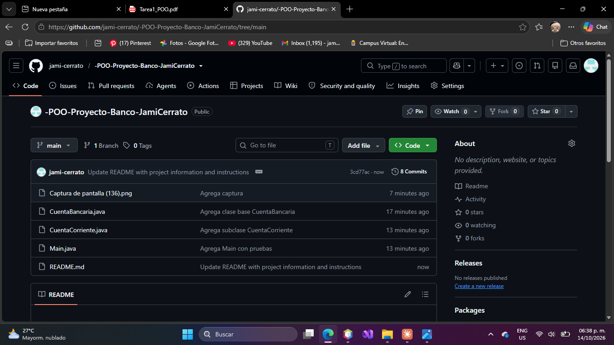

# -POO-Proyecto-Banco-JamiCerrato
**Nombre:** Jami Valesca Cerrato Zuniga
**Numero de cuenta:** 20242001155

## Instrucciones 
1. Abrir NetBeans y crear un proyecto 
2. Copiar los 4 archivos ".java" dentro del paquete del proyecto
3. Clic derecho sobre el proyecto y elegir Clean and Build
4. Clic derecho sobre `Main.java` y elegir Run File

## Captura de resultado

